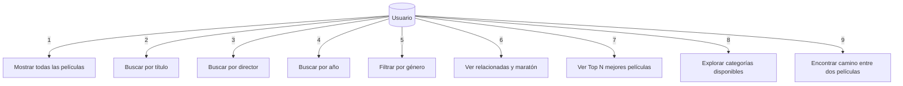

# Casos de uso — Kino

## Diagrama general

## Caso de uso: Mostrar todas las películas
- **Actor**: Estudiante universitario / profesional joven aficionado al cine.
- **Precondición**: el catálogo está cargado desde `datos/peliculas.json`.
- **Flujo principal**:
  1. El usuario selecciona `"1. Mostrar todas las películas"`.
  2. El sistema recorre el listado cargado e imprime todas las películas numeradas con sus datos completos.
- **Flujo alternativo**: si el catálogo está vacío, el sistema informa `"No hay películas registradas en el catálogo."`.
- **Postcondición**: el usuario vio la lista completa de películas disponibles.

## Caso de uso: Buscar por título
- **Actor**: Estudiante universitario / profesional joven aficionado al cine.
- **Precondición**: el catálogo está cargado y el árbol AVL de títulos está construido.
- **Flujo principal**:
  1. El usuario selecciona `"2. Buscar por título (AVL)"`.
  2. El sistema pide el título de la película.
  3. El usuario ingresa el título.
  4. El sistema lo busca en el AVL y muestra el resultado.
- **Flujo alternativo**: si no existe coincidencia, el sistema informa `"No se encontraron películas con ese título."`.
- **Postcondición**: el usuario vio los datos de la película encontrada.

## Caso de uso: Buscar por director
- **Actor**: Estudiante universitario / profesional joven aficionado al cine.
- **Precondición**: el catálogo está cargado y el árbol BST de directores está construido.
- **Flujo principal**:
  1. El usuario selecciona `"3. Buscar por director (BST)"`.
  2. El sistema pide el nombre del director.
  3. El usuario ingresa el nombre.
  4. El sistema busca en el BST (sin distinguir mayúsculas y recorriendo claves repetidas hacia la derecha) y lista todas las películas coincidentes.
- **Flujo alternativo**: si no existe coincidencia, el sistema informa `"No se encontraron películas con ese director."`.
- **Postcondición**: el usuario vio todas las películas registradas para ese director.

## Caso de uso: Buscar por año
- **Actor**: Estudiante universitario / profesional joven aficionado al cine.
- **Precondición**: el catálogo está cargado y el árbol BST de años está construido.
- **Flujo principal**:
  1. El usuario selecciona `"4. Buscar por año (BST)"`.
  2. El sistema pide el año de estreno.
  3. El usuario ingresa el año numérico.
  4. El sistema busca en el BST (incluyendo múltiples películas estrenadas en el mismo año) y muestra las coincidencias numeradas.
- **Flujo alternativo**: si no hay películas registradas en ese año, el sistema informa `"No se encontraron películas estrenadas en <año>."`.
- **Postcondición**: el usuario vio las películas correspondientes al año consultado.

## Caso de uso: Filtrar por género
- **Actor**: Estudiante universitario / profesional joven aficionado al cine.
- **Precondición**: el catálogo está cargado y el árbol BST de géneros está construido.
- **Flujo principal**:
  1. El usuario selecciona `"5. Filtrar por género (BST)"`.
  2. El sistema pide el género.
  3. El usuario ingresa el nombre del género.
  4. El sistema busca en el BST (sin distinguir mayúsculas) y muestra todas las películas pertenecientes a ese género.
- **Flujo alternativo**: si el género no existe en el catálogo, el sistema informa `"No se encontraron películas con ese género."`.
- **Postcondición**: el usuario vio el listado filtrado por género.

## Caso de uso: Ver relacionadas y maratón
- **Actor**: Estudiante universitario / profesional joven aficionado al cine.
- **Precondición**: el catálogo está cargado y el grafo no dirigido de relaciones (por género o director compartido) está construido.
- **Flujo principal**:
  1. El usuario selecciona `"6. Películas relacionadas por género/director (grafo)"`.
  2. El sistema pide el título de la película base.
  3. El usuario ingresa el título.
  4. El sistema localiza la película mediante el AVL y pregunta si desea una sugerencia estilo maratón (`s/n`).
  5. El usuario responde `s` o `n`.
  6. El sistema obtiene los vértices adyacentes en el grafo (distancia 1) y lista las películas relacionadas. Si el usuario pidió maratón, ejecuta un recorrido `DFS` desde la película base y muestra una secuencia de hasta 4 películas conectadas.
- **Flujos alternativos**:
  - Si no existe la película base, el sistema informa `"No se encontró ninguna película con el nombre '<titulo>'."`.
  - Si la película no tiene vecinos en el grafo, el sistema informa `"No se encontraron otras películas relacionadas en el catálogo."`.
- **Postcondición**: el usuario vio las películas relacionadas y, opcionalmente, una ruta de maratón de hasta 4 películas.

## Caso de uso: Ver Top N mejores películas
- **Actor**: Estudiante universitario / profesional joven aficionado al cine.
- **Precondición**: el catálogo está cargado y el montículo máximo (`MaxHeap`) ordenado por rating está construido.
- **Flujo principal**:
  1. El usuario selecciona `"7. Top N mejores películas (Montículo Máximo)"`.
  2. El sistema pregunta cuántas películas desea mostrar (`N`).
  3. El usuario ingresa un número entero.
  4. El sistema clona el montículo para no modificar la estructura principal, extrae los $N$ elementos de mayor rating (con desempate alfabético por título) y los muestra ordenados.
- **Flujo alternativo**: si `N <= 0` o el catálogo está vacío, el sistema informa `"No se encontraron películas que cumplan con los criterios."`.
- **Postcondición**: el usuario vio el ranking de las $N$ películas mejor puntuadas.

## Caso de uso: Explorar categorías disponibles
- **Actor**: Estudiante universitario / profesional joven aficionado al cine.
- **Precondición**: el catálogo está cargado y el árbol general (N-ario) de categorías está construido.
- **Flujo principal**:
  1. El usuario selecciona `"8. Mostrar categorías disponibles (N-ario)"`.
  2. El sistema muestra los géneros del primer nivel del árbol general.
  3. El sistema pregunta si desea explorar alguna categoría en particular (`nombre` o `0` para volver).
  4. El usuario ingresa el nombre de una categoría.
  5. El sistema imprime el subárbol con todas las películas dentro de ese género.
  6. El sistema pregunta si desea saber más de alguna película (`nombre` o `0` para volver).
  7. El usuario ingresa el título y el sistema muestra los datos de la película buscándola en el AVL.
- **Flujos alternativos**:
  - Si el árbol está vacío, el sistema imprime `"Árbol vacío"`.
  - Si el usuario ingresa `0` o una categoría inexistente, finaliza la exploración y vuelve al menú principal.
- **Postcondición**: el usuario navegó la jerarquía de categorías y consultó detalles de una película.

## Caso de uso: Encontrar camino entre dos películas
- **Actor**: Estudiante universitario / profesional joven aficionado al cine.
- **Precondición**: el catálogo está cargado, el grafo no dirigido de relaciones y el grafo ponderado (`GrafoPonderado`) se encuentran construidos en memoria.
- **Flujo principal**:
  1. El usuario selecciona `"9. Encontrar camino entre dos películas (BFS / Dijkstra)"`.
  2. El sistema pide el título de la película de origen y el usuario lo ingresa. El sistema lo valida mediante el AVL.
  3. El sistema pide el título de la película de destino y el usuario lo ingresa. El sistema lo valida mediante el AVL.
  4. El sistema despliega las opciones de cálculo de camino:
     - `1. Conexión más corta (menor cantidad de saltos — BFS)`.
     - `2. Ruta recomendada (transición más suave por afinidad/rating/año — Dijkstra)`.
  5. El usuario selecciona una opción (`1` o `2`).
  6. Si selecciona `1`, el sistema ejecuta la función `bfs_camino_mas_corto` sobre el grafo y muestra en pantalla la cadena óptima en cantidad de saltos (aristas).
  7. Si selecciona `2`, el sistema ejecuta el algoritmo de `dijkstra` sobre el grafo ponderado y muestra la ruta de menor costo acumulado junto con el detalle del costo de cada tramo de transición.
- **Flujos alternativos**:
  - Si no se encuentra la película de origen o la de destino ingresada, el sistema informa que no existe ninguna película con ese nombre y reanuda el menú.
  - Si no existe un camino físico o ponderado que conecte ambas películas, el sistema informa `"No existe un camino que conecte ambas películas."`.
  - Si el usuario selecciona un criterio numérico inválido, el sistema emite un aviso de opción no válida.
- **Postcondición**: el usuario visualizó el trayecto de conexión óptimo (por amplitud o por costos de afinidad) entre ambas obras del catálogo.